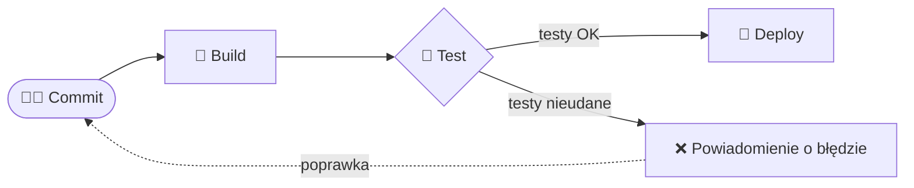

# Zadanie 6: Pierwszy diagram Mermaid

## Prompt

> Stwórz prosty diagram Mermaid pokazujący proces CI/CD: commit → build → test → deploy.

## Kod Mermaid

## Opis wygenerowanego diagramu (Mermaid Live Editor – https://mermaid.live)

Po wklejeniu kodu do Mermaid Live Editor wyświetla się diagram przepływu ułożony **od lewej do prawej** (`flowchart LR`):

1. **Commit** – zaokrąglony prostokąt (kształt „stadionu”) – punkt startowy, programista wypycha zmiany do repozytorium.
2. **Build** – prostokąt – kompilacja / budowanie aplikacji.
3. **Test** – romb (decyzja) – uruchomienie testów automatycznych; z rombu wychodzą dwie strzałki:
   - „testy OK” → **Deploy** – prostokąt – wdrożenie aplikacji na serwer,
   - „testy nieudane” → **Powiadomienie o błędzie**.
4. Od powiadomienia biegnie **przerywana** strzałka „poprawka” z powrotem do **Commit**, pokazując, że proces jest pętlą – po poprawieniu kodu cykl zaczyna się od nowa.

Diagram jasno pokazuje, że wdrożenie następuje tylko wtedy, gdy testy przejdą pomyślnie.
